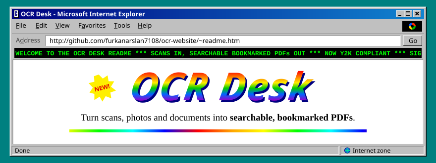
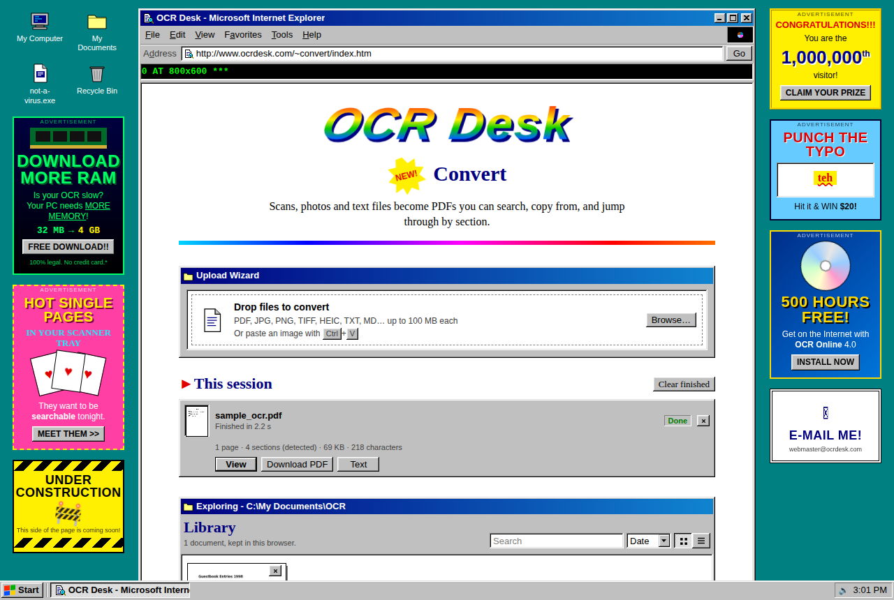
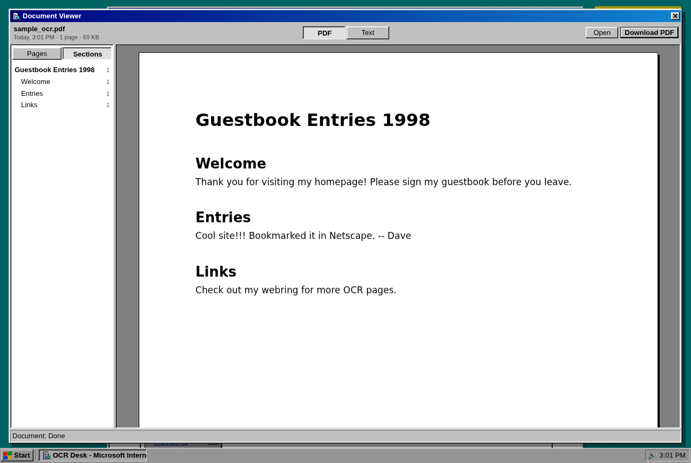
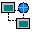
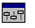
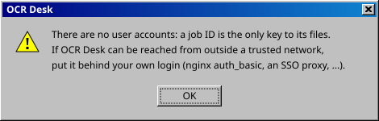

<p align="center">
  
</p>

<p align="center">
  
  
  
  
  
  <a href="LICENSE"></a>
  
  
</p>

<p align="center">
  <a href="#quick-start"><b>Quick start</b></a> |
  <a href="#architecture">Architecture</a> |
  <a href="#configuration">Configuration</a> |
  <a href="#api">API</a> |
  <a href="#ocr-modes">OCR modes</a> |
  <a href="#notes">Notes</a>
</p>

<p align="center">
  
  <br>
  <sub>&#9650; An actual screenshot. Pop-up ads included at no extra charge.</sub>
</p>

## What it does

Drop in PDFs, plain-text/Markdown files or images (JPG, PNG, TIFF incl. multi-page, HEIC, WebP, BMP, GIF).
Each file is converted to PDF, OCR'd with Tesseract or PaddleOCR (your pick per job), and given a navigable outline (bookmarks):

- Existing structure is kept: a PDF's own bookmarks carry straight through.
- Otherwise headings are **detected** from the text layer: larger-than-body lines and numbered
  headings (`2.1 Methods`, `Chapter 3`, `IV. Results`), with running headers/footers filtered out.
- Multi-page documents without detectable headings get one bookmark per page.
- **Combine** several files into one PDF, and each file becomes a top-level section with its headings nested.

You also get a plain-text export of every job.

<details>
<summary><b>&#x1F449; CLICK HERE for MORE SCREENSHOTS!!</b></summary>
<br>
<p align="center">
  
  <br>
  <sub>The viewer: every detected heading becomes a bookmark you can jump to.</sub>
</p>
</details>

## Quick start

```bash
cp .env.example .env     # optional: tweak port, languages, limits
docker compose up -d --build
```

Open <http://localhost:8080>. The first build takes a few minutes (about as long as a 56k modem download of one JPEG).

## Architecture

```
browser ──► nginx :80 ──► static frontend (vanilla JS, no build step)
              │
              ├─ /api/* ──► FastAPI backend (internal network, no internet access)
              │               └─ job queue ─► img2pdf / text layout ─► OCRmyPDF (Tesseract | PaddleOCR) ─► PyMuPDF (outline, text)
              │
              └─ /protected/* (internal) ◄── X-Accel-Redirect: nginx streams result files from the shared volume
```

| Piece | Choice | Why |
|---|---|---|
| OCR | OCRmyPDF 17 + Tesseract 5 | Industry-standard searchable PDFs; parallel per page; deskew/rotation/cleaning |
| Alt. OCR engine | PaddleOCR PP-OCRv6 via RapidOCR (ONNX Runtime) | Often better on photos and low-quality scans; an OCRmyPDF plugin (`paddle_ocr.py`), so rotation, deskew and optimisation still apply. ONNX Runtime instead of PaddlePaddle: same models, ~10x smaller install, no AVX requirement |
| Text → PDF | PyMuPDF Story | TXT/MD laid out on A4; Markdown `#` headings become bookmarks |
| Images → PDF | img2pdf + Pillow | Lossless; original JPEG bytes are embedded without re-encoding |
| Sectioning | PyMuPDF | Fast text/font-size extraction and outline writing |
| API | FastAPI, single process | Jobs run in an in-process bounded queue: no Redis/Celery to operate |
| Web | nginx | Static files, upload streaming, zero-copy downloads |

Jobs live in a Docker volume and are deleted `JOB_TTL_MINUTES` after they finish (default 2 h).
Uploaded originals are deleted as soon as a job completes. Finished jobs survive a backend restart.

When a job finishes, the frontend copies the PDF and text into the browser's IndexedDB, so the
Library and the viewer keep working after the server copy expires. Those copies stay on the
user's device until they are deleted from the Library. Page thumbnails are rendered in the browser
with PDF.js, vendored under `frontend/vendor/pdfjs/` (see `VERSION` there).

## Configuration

All settings are environment variables. See [`.env.example`](.env.example).

| Variable | Default | Notes |
|---|---|---|
| `HTTP_PORT` | `8080` | Published port |
| `OCR_LANGS` | `eng tur deu fra spa ita por nld` | Tesseract packs baked into the image (build arg) |
| `DEFAULT_LANGUAGE` | `eng` | Used when none is selected |
| `PADDLE_MODEL` | `small` | PaddleOCR model size baked into the image (build arg): `small` or `medium` (slightly more accurate, ~8x slower on CPU) |
| `MAX_CONCURRENT_JOBS` | `2` | Jobs processed at once; the rest queue |
| `OCR_JOBS` | all cores | CPU workers per job |
| `OCR_OPTIMIZE` | `1` | `0` = fastest, `1` = lossless, `2`/`3` = smaller, slower |
| `MAX_FILE_MB` / `MAX_FILES_PER_JOB` / `MAX_PAGES_PER_JOB` | `100` / `20` / `1000` | Limits |
| `JOB_TTL_MINUTES` | `120` | Result retention |

## API

| Method | Path | |
|---|---|---|
| `GET` | `/api/config` | Languages, limits, accepted types |
| `POST` | `/api/jobs` | multipart: `files` (1..n; several = combined), `languages` (`eng+tur`), `mode` (`auto`/`redo`/`force`), `engine` (`tesseract`/`paddle`), `rotate`, `deskew`, `clean`, `title` |
| `GET` | `/api/jobs/{id}` | Status, progress, and result (pages, sections, …) |
| `GET` | `/api/jobs/{id}/pdf` · `/txt` | Download (`?inline=true` to view in the browser) |
| `DELETE` | `/api/jobs/{id}` | Cancel (kills running OCR) and delete |

Interactive docs: <http://localhost:8080/api/docs>

```bash
curl -F files=@scan.pdf -F languages=eng http://localhost:8080/api/jobs
```

## OCR modes

- **Auto** (`--skip-text`): OCRs only pages without text. Fastest; digital text is untouched.
- **Redo** (`--redo-ocr`): replaces an old/bad OCR layer while keeping real text. Deskew is unavailable.
- **Force** (`--force-ocr`): rasterizes and OCRs every page. Use for broken text layers.

## Notes

<p align="center">
  
</p>

- Job IDs are unguessable 128-bit tokens and act as the access key. There are no user accounts, so put the app
  behind your own auth (e.g. an nginx `auth_basic` or SSO proxy) if it is exposed beyond a trusted network.
- Word/ODT/RTF input is not supported (LibreOffice was dropped to keep the image small). Export those to PDF first.
- PyMuPDF is AGPL-licensed (commercial licence available from Artifex). This is fine for self-hosting, but check it
  if you plan to distribute a modified version.

<br>

<p align="center">
  
</p>

<p align="center">
  You are visitor number 
</p>

<p align="center">
  <a href="https://github.com/furkanarslan7108/ocr-website/issues/new">Sign my Guestbook</a> |
  <a href="https://github.com/furkanarslan7108/ocr-website/issues">View my Guestbook</a> |
  <a href="https://github.com/ocrmypdf/OCRmyPDF">&lt;&lt; Prev</a>
  <a href="https://github.com/topics/ocr"><b>OCR WebRing</b></a>
  <a href="https://github.com/tesseract-ocr/tesseract">Next &gt;&gt;</a>
</p>

<p align="center">
  
</p>

<p align="center">
  <sub>&copy; 1998 OCR Desk. Best viewed in Netscape Navigator 4.0 at 800&times;600 in 256 colors.<br>
  Released under the <a href="LICENSE">MIT License</a>.</sub>
</p>
